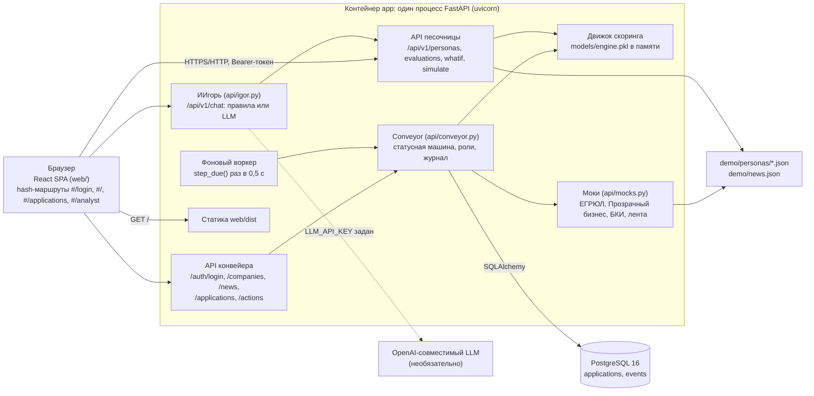
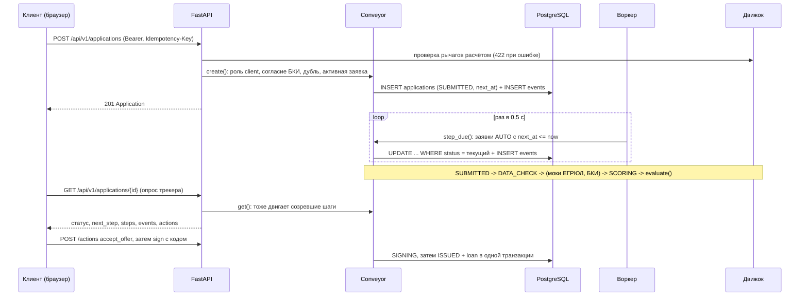

# Архитектура МойАльфаКредит

## Схема компонентов

## Компоненты

| Компонент | Файл | Ответственность |
|---|---|---|
| Приложение и маршруты | `api/app.py` | создание FastAPI (`create_app`), модели запросов pydantic, воркер в `lifespan`, раздача `web/dist` |
| Песочница | `api/app.py`, `scoring/whatif.py`, `api/dto.py` | расчёт оценки, сценарии «что если», развёртка кривых; ответы кэшируются по (компания, рычаги), движок детерминирован |
| Конвейер | `api/conveyor.py` | таблицы, статусная машина, автоматические шаги, действия клиента и аналитика, представление заявки |
| Вход | `api/auth.py` | демо-учётки, HMAC-SHA256 токен с ролью и сроком 12 ч, зависимость `user` |
| Моки | `api/mocks.py` | ЕГРЮЛ / «Прозрачный бизнес» по ИНН, доступность БКИ, персональная лента новостей |
| ИИгорь | `api/igor.py` | разбор запроса правилами или tool calling к LLM; числа в ответе LLM — только плейсхолдеры |
| Демо-данные | `api/personas.py`, `demo/` | загрузка демо-компаний, проверка ИНН, сборка заявки из фактов и рычагов |
| Фронт | `web/src` | песочница, онбординг по ИНН, трекер, мои заявки, кабинет аналитика, лента, чат |
| База | PostgreSQL 16.6 (compose), SQLite локально и в тестах | хранение заявок и журнала событий |

## Поток подачи заявки

Порядок решения после скоринга: стоп-фактор → `REJECTED`; движок просит документы → `NEEDS_DATA`; ручной
маршрут (сумма больше `AUTO_MAX_AMOUNT` = 10 млн ₽ или продукт `secured`) → `ANALYST`; иначе исход движка
(`APPROVED` / `COUNTER_OFFER` / `REJECTED`). Сбой БКИ на шаге `DATA_CHECK` сразу ведёт в `ANALYST`.

## Инженерные решения (как реализовано в коде)

- **Атомарные переходы.** Статус меняет только `Conveyor._move`: `UPDATE applications ... WHERE id = ? AND
  status = <ожидаемый>` и запись в `events` в одной транзакции. Не совпал статус — HTTP 409 «Заявка уже
  изменилась». Параллельные действия и повторный проход воркера не задваивают переход; выдача (`loan`)
  пишется в том же переходе в `ISSUED`.
- **Журнал аудита.** Каждый переход, включая подачу, — строка `events` с `from_status`, `to_status`, `actor`
  (`client` / `system` / `analyst`), комментарием и `correlation_id` (uuid4).
- **Идемпотентность подачи.** Заголовок `Idempotency-Key`: повтор с тем же ключом от того же пользователя
  возвращает ту же заявку; уникальность (`owner`, `idempotency_key`) закреплена ограничением в БД. Вторая
  активная заявка той же компании и продукта — 409.
- **Проверка ролей.** Каждое действие проверяется по роли из подписанного токена: клиент — `upload_documents`,
  `accept_offer`, `sign`, `withdraw`; аналитик — `approve`, `counter`, `reject`, `request_info` (с обязательным
  комментарием). Чужое действие — 403, клиент видит только свои заявки (чужая — 404), подавать может только клиент.
- **Факты не из клиента.** В запросе клиент меняет только рычаги; факты компании берутся из файла демо-компании,
  дополнения из документов хранятся в `facts_patch` заявки.
- **Stateless API + БД.** Состояние заявок только в базе; процесс можно перезапустить.
- **Воркер переживает перезапуск.** Автоматические шаги не держатся в памяти: заявка хранит `next_at`, воркер
  и чтение заявки двигают созревшие заявки, поэтому после рестарта конвейер продолжает с того же места.
- **Healthcheck.** `db` — `pg_isready`, `app` стартует только после здоровой базы; у образа приложения
  HEALTHCHECK на `GET /api/health`.
- **Закреплённые версии.** Python-зависимости с точными версиями (`deploy/requirements-server.txt`), npm —
  точные версии и `package-lock.json`, образы `node:22.12.0-slim`, `python:3.13.1-slim`, `postgres:16.6-alpine`.
- **Проверка версии модели.** `Engine.load` отказывается грузить `engine.pkl`, обученный прошлой версией признаков
  модели одобрения (`APPROVAL_VERSION`).
- **Непривилегированный пользователь.** Приложение в контейнере работает под системным пользователем `app`.
- **Страж чисел ИИгоря.** Ответ LLM, где число с ₽/%/млн стоит вне плейсхолдера, отбрасывается, ответ строится
  правилами; ошибка LLM — тоже ответ правилами.

## Ограничения

- Демо-авторизация: учётки в `api/auth.py`, токен HMAC без отзыва; в банке её заменит корпоративный IdP (OIDC)
  с тем же контрактом Bearer-токена.
- Миграций (Alembic) нет: схема создаётся `metadata.create_all` при старте.
- Воркер — корутина в единственном процессе приложения; для нескольких реплик нужен отдельный воркер.
- Внешние интеграции — моки за одним HTTP-контрактом (`api/integrations.py`, см. `THIRD_PARTY_NOTICES`). Реестры,
  БКИ и лента: адрес сервиса задаётся в `REGISTRY_URL`, `BKI_URL`, `NEWS_URL`; задан — запрос по HTTP (у БКИ три
  попытки, затем заявка уходит аналитику), пусто — встроенный мок с тем же ответом. Встроенные моки отвечают и по
  HTTP на `/api/mock/*`, поэтому настоящий сервис банка подключается сменой адреса, без правок конвейера.
