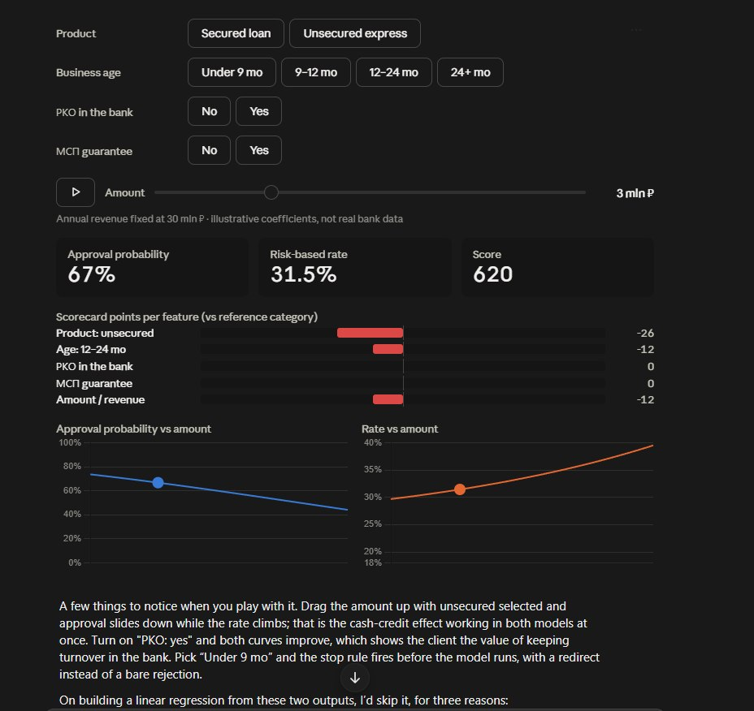
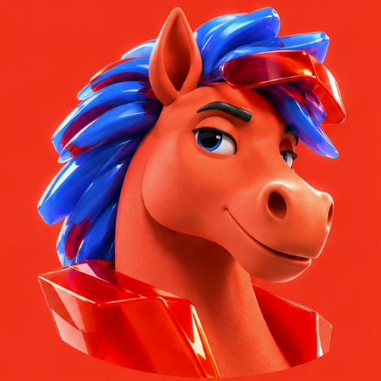

# МойАльфаКредит · «Песочница кредита» и ИИгорь

ТЗ для фронтенда, бэкенда и UI/motion-дизайна. Версия 25.10.2026, движок скоринга — main `b4c6cba`.

Главный экран кабинета — интерактивный дашборд в духе референса ниже, только на **настоящих моделях** движка:
PD-скоркарта, модель шанса одобрения, кредитная логика с лимитом, risk-based ставка с капиталом по ПВР, ПСК и
what-if. Ведёт клиента **ИИгорь** — ИИ-агент в n8n в образе коня: разговаривает, собирает заявку и сам выкладывает на
экран нужные блоки (generative UI). Клиент меняет условия прямо на графиках (direct manipulation), и каждое изменение
анимировано и объяснено.

| Референс дашборда | ИИгорь |
|---|---|
|  |  |

Визуальные референсы Альфа-Банка (Behance): [3D illustrations for Alfa-Bank, 2024](https://www.behance.net/gallery/216736451/3D-illustrations-for-Alfa-Bank),
[Alfa-Bank visual 3D case](https://www.behance.net/gallery/200917627/3D-illustrations-for-Alfa-Bank),
[Alfa Bank — стиль для офлайн-рекламы](https://www.behance.net/gallery/236099329/Alfa-Bank).

---

## 0. Коротко

- **Что строим:** чат с ИИгорем → анкета по ИНН → «Песочница кредита» (дашборд) → подача → трекер → решение.
  Тот же дашборд в кабинете аналитика банка, но с PD и разблокированными фактами.
- **Три правила, которые нельзя нарушать:**
  1. **ИИгорь не считает, он показывает.** Любое число на экране пришло из сервиса скоринга. LLM выбирает блоки и
     пишет слова, но не придумывает цифры.
  2. **Каждый график — это ещё и контрол.** Сумму можно тащить прямо по кривой, сценарий «что если» — перетащить
     в заявку.
  3. **Без тупиков.** У каждого исхода есть следующий шаг: контрпредложение с причиной, другой продукт, список
     документов или понятный отказ с тем, что изменить.
- **Кто что делает:** фронт — §4, §6, §8, §11; бэк — §9, §10; UI/motion — §5, §7, §8; n8n — §6, §10.

## 1. Для кого

**Клиент** — собственник или финдиректор МСБ (только юрлица, ИНН из 10 цифр). Сквозной персонаж демо — Марина,
ООО «Тёплый дом», селлер, ОКВЭД 47.91, хочет 6 млн ₽ на закупку к сезону. Обещания продукта:

- знаете ответ до подачи — шанс одобрения и ориентир суммы без запроса в кредитную историю;
- вводите только сумму, срок и цель — остальное подтягиваем по ИНН;
- видите, где заявка и чей сейчас ход.

**Аналитик банка** видит ту же заявку с PD, классом риска, баллом скоркарты, стоп-факторами и полным разложением.

## 2. Принципы интерфейса

| # | Принцип | Что это значит на практике |
|---|---|---|
| 1 | Числа — только из API | На фронте нет формул скоринга, ставки или лимита. Фронт только форматирует. Единственное исключение — интерполяция по уже полученной кривой во время перетаскивания (§4.4) |
| 2 | Рычаги и факты разделены | Клиент меняет то, что может поменять в жизни: продукт, сумму, срок, РКО и обороты в банке, гарантию МСП, данные маркетплейса, страховку, подписку. Выручка, возраст бизнеса, долг, БКИ и налоговый долг — **факты** из ФНС, ГИР БО, ЕГРЮЛ и БКИ: заблокированы, у каждого бейдж источника и даты. В режиме аналитика факты можно разблокировать, тогда весь экран помечен «гипотетический расчёт» |
| 3 | Direct manipulation | Объект виден всё время, действие физическое (тащить, а не вводить в форму), изменение мгновенное, инкрементальное и обратимое (undo) |
| 4 | Мгновенный отклик | Во время перетаскивания — до 16 мс (локально по кривой), точные числа — до 300 мс после отпускания |
| 5 | Объяснимость | У каждого числа есть «почему»: вклад признаков, водопад ставки, код того, что ограничило сумму |
| 6 | Честные пометки | «Предварительная оценка, не решение банка»; бейдж «предоценка без БКИ» в soft-режиме; «параметры цены иллюстративные» в подвале |
| 7 | Доступность | Всё, что можно потянуть мышью, можно сделать с клавиатуры; у каждого графика есть табличный вид; `prefers-reduced-motion` уважается |

## 3. Экраны и путь

```
Клиент:  Чат с ИИгорем → ИНН → Анкета (автозаполнение) → Песочница кредита → Подача → Трекер статусов
                                                          ↑ ИИгорь живёт рядом      → Решение → Подписание (мок) → Карточка кредита
Банк:    Очередь заявок → Карточка заявки (та же песочница + PD, класс, стоп-факторы, факты разблокируемы)
```

Статусы заявки и «чей ход» — как в тексте защиты, слайд 11: Черновик → Предоценка готова → Подана → Проверка данных
→ (Нужны данные) → Скоринг → (У аналитика) → Одобрено / Контрпредложение / Отказ с причиной → Подписание → Выдано;
Отозвана — до решения. Статус меняет только бэкенд, недопустимый переход API отклоняет.

### 3.1 Золотой путь демо (приёмочный тест UI)

Цифры посчитаны движком (текст защиты, слайды 07 и 12). Прототип должен показать их же на тестовой компании T2.

| Шаг | Что на экране | Числа |
|---|---|---|
| 1 | Марина пишет: «Нужно 6 млн на закупку к Новому году, маркетплейс платит с задержкой 2–3 недели». ИИгорь распознаёт задачу и просит ИНН | `{ "need": "PURCHASE", "amount_rub": 6000000, "term_months": 12 }` |
| 2 | Анкета заполняется сама, руками — сумма, срок, цель | — |
| 3 | Песочница в soft-режиме (без БКИ): бейдж «предоценка», шанс одобрения | 58% |
| 4 | Согласие на БКИ → пересчёт, бейдж уходит, тикер шанса анимируется 58 → 63 | 63%; PD 1,63%, класс 3, балл 602 (видит аналитик) |
| 5 | Сумма 6 млн, срок 12 мес → исход «Другая сумма»: на кривой видно, что лимит 3,61 млн, причина L02 | 3,61 млн ₽, ставка 19,0%, ПСК 26,0% |
| 6 | Карточка «Взять на 24 месяца» → наведение показывает призрак кривой → «Применить» → исход «Одобрим» | 6 млн ₽, ставка 19,7% |
| 7 | «Подать» → трекер → решение → подписание (мок) → карточка кредита | — |

## 4. Песочница кредита (дашборд)

### 4.1 Раскладка

Десктоп от 1280 px: рабочая область 8–9 колонок из 12, справа панель ИИгоря 3–4 колонки (сворачивается).

```
┌────────────────────────────────────────────────────────────────────┬─────────────────────┐
│ ООО «Тёплый дом» · ИНН ··· · отчётность ГИР БО 2025 · данные на D-1 [Факты ▾]│  ИИгорь             │
├────────────────────────────────────────────────────────────────────┤  (аватар-состояние)  │
│ РЫЧАГИ                                                              │                     │
│ Продукт   [Залоговый] [Экспресс●] [Овердрафт 🔒] [Линия] [Селлерам] [Карта]│  чат, блоки,        │
│ Срок      [6] [12●] [18] [24] [36]                                   │  быстрые ответы     │
│ РКО в Альфе [нет|да]   обороты в месяц ──●── ··· ₽                    │                     │
│ Гарантия МСП [нет|да]   Маркетплейс [нет|да]   Страховка [нет|да]     │                     │
│ ▶  Сумма ─────────────────────●──────────────────  6 млн ₽          │                     │
├──────────────┬──────────────┬──────────────┬───────────────────────┤                     │
│ Шанс одобрения│ Ставка        │ Платёж в мес. │ Исход                 │                     │
│ 63%  ▲+5 п.п. │ 19,0% · ПСК 26,0% │ ··· ₽     │ Другая сумма: 3,61 млн│                     │
│               │ на 3,61 млн   │               │ L02 денежный поток    │                     │
├──────────────┴──────────────┴──────────────┴───────────────────────┤                     │
│ Почему такой шанс (вклад, баллы)    │ Из чего ставка (водопад)      │                     │
├──────────────────────────────────────┼───────────────────────────────┤                     │
│ Шанс одобрения от суммы (зоны, лимит)│ Ставка и ПСК от суммы          │                     │
├──────────────────────────────────────┴───────────────────────────────┤                     │
│ ЧТО ЕСЛИ  [Взять на 24 мес] [Открыть РКО…] [Гарантия МСП] [Залог] …   │                     │
├──────────────────────────────────────────────────────────────────────┤                     │
│ [Сохранить вариант A] [Сравнить]                       [Подать заявку →] │                     │
└──────────────────────────────────────────────────────────────────────┴─────────────────────┘
```

Мобильный (375 px): шапка компании → плитки KPI каруселью → кривая шанса на всю ширину (высота 200 px) → «Что если»
каруселью → рычаги в нижнем листе по кнопке «Изменить условия» → ИИгорь — аватар 56 px в углу, чат в нижнем листе.

### 4.2 Рычаги

Список продуктов, их минимумы и максимумы, доступность и подписи приходят из `GET /api/v1/meta` (§9.2), а не зашиты во фронт.

| Рычаг | Поле заявки | Значения | Когда недоступен |
|---|---|---|---|
| Продукт | `product` | `secured` залоговый кредит, `express` экспресс-кредит без залога, `overdraft` овердрафт, `credit_line` кредитная линия, `seller_credit` кредит селлерам, `card` бизнес-карта | Чип с замком и причиной: E01 «бизнес слишком молодой для продукта: нужно от N мес.», E02 «нужен расчётный счёт в банке», E03 «нужен магазин на маркетплейсе с переданными данными». Клик по закрытому чипу — объяснение и путь «как открыть» (например, сценарий РКО) |
| Сумма | `requested_amount` | Слайдер в **логарифмической** шкале от минимума продукта до его максимума (300 тыс. – 10 млн у экспресса, до 300 млн у линии); насечки 1 / 3 / 10 / 30 млн. Шаг округления — 10 000 ₽ | — |
| Срок | `requested_term_m` | Чипы 6 / 12 / 18 / 24 / 36 мес. и «другой» | У овердрафта и карты скрыт: «продукт возобновляемый, срок не нужен» |
| РКО в Альфе | `has_rko` | нет / да | — |
| Обороты по счёту в Альфе | в UI ₽ в месяц → `bank_turnover_ratio` | Слайдер в рублях; бэкенд пересчитывает в долю от суммы (§9.3), поэтому при перетаскивании суммы месячный оборот остаётся тем же, как в сценарии `amount_to_limit` | Скрыт, пока РКО = нет |
| Гарантия Корпорации МСП | `guarantee` | нет / да | У карты и овердрафта |
| Данные маркетплейса | `marketplace` | нет / да | Только для раздела ОКВЭД G (торговля) |
| Страховка | `insurance` | нет / да | У залогового кредита обязательна — включена и заблокирована |
| Подписка на пакет услуг | `subscription` | нет / да | — |

Залог в движке — это продукт `secured`, отдельного флажка нет. Возраст бизнеса — факт, а не рычаг. Чипы возраста
со скриншота появляются только в режиме аналитика при разблокировке фактов.

**Кнопка ▶ у суммы** (как на скриншоте): проигрывает развёртку суммы от минимума до максимума за 4 с, точка едет
по обеим кривым, на лимите делает паузу 600 мс с подсказкой «здесь заканчивается денежный поток». Повторное
нажатие — стоп. Данные — из уже полученного `/api/v1/simulate`, без новых запросов.

### 4.3 Плитки KPI

| Плитка | Поле | Подпись и детали |
|---|---|---|
| Шанс одобрения | `approval_probability` (0..1) | Большое число в процентах, тикер с анимацией. Дельта к прошлому состоянию «▲ +5 п.п.» живёт 2 с. В soft-режиме — бейдж «предоценка: нет данных — …» со списком из `approval_imputed` |
| Ставка | `pricing.rate`, `pricing.all_in` | «19,0% · ПСК 26,0%». **Обязательно подпись, на какую сумму ставка:** цена считается на сумму предложения `offered_amount`, а не на запрошенную. Клик — водопад ставки (§4.6) |
| Платёж в месяц | `monthly_payment` (новое поле, §9.3) | Аннуитет по сумме предложения и ставке. Фронт его **не считает** |
| Исход | `outcome` + `offered_amount` + первая причина | APPROVE «Одобрим», COUNTER «Предложим другую сумму» или «Предложим другой продукт» (если есть `route`), REQUEST_INFO «Нужны документы», REJECT «Сейчас не сможем». Иконка и текст, цвет — не единственный сигнал |

Режим аналитика добавляет вторую строку: PD (`pd`), класс риска 1–7 (`risk_class`), балл скоркарты (`score`: 600
баллов при шансах 50:1, +20 баллов — вдвое ниже шанс дефолта), балл одобрения (`approval_score`). Клиенту PD и класс
риска не показываем: у него «шанс одобрения» и причины словами.

### 4.4 Кривые: шанс и ставка от суммы

Две кривые, как на скриншоте, но с тем, чего там нет:

- **Зоны исхода по оси суммы.** Каждая точка `/api/v1/simulate` несёт `outcome`. Под кривой — полосы фона: «одобрим»,
  «предложим другую сумму», «другой продукт / не сможем». Переходы между зонами — главный смысл графика.
- **Вертикаль лимита** с подписью кода: «Лимит 3,61 млн — потолок по денежному потоку (L02)». Коды L01–L06 — §4.8.
- **Точка текущей суммы — draggable.** Её можно тянуть вдоль кривой: это тот же контрол, что и слайдер, они
  синхронны. Во время перетаскивания значения KPI берутся **интерполяцией по точкам кривой** (60 fps без сети);
  на отпускании — точный `POST /api/v1/evaluations`, и числа плавно доезжают до точных.
- **Ставка от суммы:** сплошная линия — ставка, пунктир — ПСК. Не сглаживайте ступеньки: на 70 млн ₽ заявка
  переходит из розничного МСП в корпоративный класс ПВР и вес риска меняется скачком, у малых сумм ставку
  поднимают фиксированные расходы. Тултип на ступеньке объясняет её. Форму кривой рисуем ту, что пришла с бэка —
  она не обязана расти, как на скриншоте.
- Переключатель оси «сумма | срок» — тот же график по сроку (`axis: requested_term_m`).
- «Показать таблицей» — те же точки таблицей (доступность).

### 4.5 Почему такой шанс — вклад признаков

Горизонтальные бары от нуля, как на скриншоте «Scorecard points per feature». Источник — `approval_explain`:
вклад каждого признака в балл одобрения относительно референсной категории (у непрерывных — относительно среднего
по обучению). Шкала баллов: +20 — шансы на одобрение вдвое выше.

- Строка: «Признак: категория» и число баллов со знаком; сортировка по модулю; первые 5 видны, остальное под «ещё».
- Признаки модели: продукт, возраст бизнеса, РКО в банке, обороты в банке к лимиту, сумма к годовой выручке,
  селлер маркетплейса с данными, гарантия Корпорации МСП, просрочки в БКИ за 12 мес., PD скоркарты, запас
  денежного потока к платежу, среднемесячный оборот к платежу.
- Вклады бывают очень разными по масштабу (на реальной компании запас денежного потока дал +197 баллов, а продукт
  −17), поэтому шкала — по максимальному модулю, длинный бар обрезается со стрелкой и подписью значения.
- Категории приходят «сырыми» (`credit_line`, `36-60`, `да`) — подписи человеческим языком отдаёт бэкенд (§9.3).
- Клик по бару подсвечивает связанный рычаг (РКО, гарантия, сумма). Если рычага нет (PD, возраст), открывается
  объяснение, что это факт.
- При изменении рычага бары перестраиваются FLIP-анимацией: меняют длину и порядок, а не перерисовываются.

Для аналитика рядом вторая вкладка — **коды причин скоркарты** `reasons`: категории с потерей баллов
(«высокая долговая нагрузка −9,5 балла»).

### 4.6 Из чего ставка — водопад

Источник — `pricing`. Шаги слева направо: фондирование (G-кривая Мосбиржи на `curve_date` + спред) + ожидаемые
потери PD×LGD + капитал + расходы + маржа − скидки = **ставка**; затем + комиссия + страховка → **ПСК**. Наведение на
шаг — одна строка объяснения. Для аналитика: вес риска `risk_weight`, класс ПВР `irb_class` (розничное МСП /
корпоративное, базовый ПВР / стандартный подход), LGD для капитала `lgd_capital`. В подвале: «параметры цены
иллюстративные».

### 4.7 Что если

Источник — `POST /api/v1/whatif` → `scenarios`. Бэкенд присылает **только применимые** к заявке сценарии.

| key | Карточка | Когда приходит |
|---|---|---|
| `collateral` | Добавить залог недвижимости | продукт не залоговый |
| `rko_turnover` | Открыть РКО и вести обороты в банке ≥ 40% лимита | нет РКО или оборотов мало |
| `guarantee` | Получить гарантию Корпорации МСП | нет гарантии, продукт не карта и не овердрафт |
| `amount_to_limit` | Запросить сумму в пределах лимита | контрпредложение по тому же продукту |
| `term_24` | Взять на 24 месяца | срок меньше 24, продукт не овердрафт и не карта |
| `marketplace` | Подключить данные маркетплейса | раздел ОКВЭД G, данных нет |
| `no_insurance` / `add_insurance` | Отказаться от страховки / Оформить страховку | продукт не залоговый |

Карточка: 3D-иконка, заголовок, дельты «шанс +NN п.п.», «ставка −N,N п.п.», смена исхода («→ Одобрим 6 млн»).
Сортировка — по росту шанса, затем по снижению ставки. Взаимодействия:

- **Наведение / долгое нажатие** — «призрак»: пунктирная кривая и призрачные значения KPI нового состояния (150 мс
  fade), ничего не применяется.
- **Клик «Применить»** — рычаги анимированно переезжают в новое состояние, все блоки пересчитываются.
- **Drag & drop** карточки на панель рычагов — то же, что «Применить». С клавиатуры: фокус на карточке, Enter.
- Undo: `Ctrl+Z` и чип «Отменить: Взять на 24 месяца» на 5 с.

### 4.8 Решение и причины

Тексты причин всегда из поля `category` ответа API: фронт не хранит свои формулировки и не переводит коды. Коды
показываем только аналитику и пишем в аналитику событий.

| Исход | Что показываем | Кнопки |
|---|---|---|
| APPROVE | «Одобрим N ₽ на M мес.» + блок «Что снижает балл» (коды R, мягко, необязательно) | Подать заявку |
| COUNTER, тот же продукт | Одна причина L-кода и шаблон: «Можем выдать 3,61 млн ₽ на 12 месяцев. Почему: прибыль бизнеса с запасом покрывает платёж только по этой сумме. Что можно сделать: …» + 1–2 лучших сценария | Взять 3,61 млн · Посмотреть варианты |
| COUNTER с `route` | «Кредитная линия пока недоступна: <route.reasons>. Можем предложить бизнес-карту на N ₽» | Взять бизнес-карту · Что нужно для линии |
| REQUEST_INFO | Чек-лист документов из `requests` с загрузкой прямо в кабинете; «срок рассмотрения на паузе» | Загрузить |
| REJECT | Причины `stop_factors` и `reasons` спокойным языком, что можно изменить и когда вернуться | Пересчитать позже · Связаться с менеджером |

Справочник кодов движка (единый для фронта, бэка и n8n; бэкенд отдаёт его в `/api/v1/meta`):

| Группа | Коды | Смысл |
|---|---|---|
| S — стоп-факторы | S01–S07 | Текущая просрочка > 30 дн., просрочка > 90 дн. за 12 мес., налоговый долг > 5% оборота, компании < 3 мес., класс риска 7, вид деятельности вне политики, компания не действующая |
| E — продукт недоступен | E01–E03 | Молодой бизнес для продукта, нужен РКО, нужен магазин на маркетплейсе |
| L — что ограничило сумму | L01–L06 | L01 денежного потока не хватает даже на минимум, L02 денежный поток при DSCR ≥ 1,25, L03 доля оборота по классу риска, L04 максимум продукта, L05 обороты в банке у овердрафта, L06 сумма меньше минимальной |
| R — что снижает балл скоркарты | R01–R12 | Долговая нагрузка, короткая история, просрочки, налоговый долг, сезонность, оборот, денежный поток, отрасль, структура капитала, без залога, нет оборотов в банке, сумма велика к обороту |

⚠ Прототип n8n и `/decide` сейчас используют свой справочник R01–R09 со значениями, которые расходятся с движком
(R03 там «обороты не покрывают платёж», в движке — «просрочки»). Решение для этого ТЗ: **источник правды — движок**,
прототипный справочник выводим из оборота.

### 4.9 Сравнение вариантов

«Сохранить вариант» закрепляет текущее состояние рычагов и ответа (до 3 вариантов: A, B, C). «Сравнить» — колонки
рядом: сумма, срок, исход, шанс, ставка, ПСК, платёж, переплата; отличия подсвечены. Из любой колонки — «Подать этот
вариант».

### 4.10 Состояния экрана

| Состояние | Поведение |
|---|---|
| Загрузка первого расчёта | Скелетоны блоков, ИИгорь в состоянии «думаю». Никаких спиннеров на весь экран |
| Пересчёт после рычага | Старые числа остаются, становятся полупрозрачными на 60%, затем доезжают до новых. Устаревший ответ отменяется (`AbortController`), применяется только последний |
| Soft-режим | Бейдж «предоценка без БКИ / отчётности» и список недостающих данных с кнопкой «дать согласие / загрузить» |
| Ошибка заявки (422) | Текст ошибки у соответствующего рычага, остальной экран живой |
| Сервис скоринга недоступен | Баннер, последние числа помечены «на hh:mm», рычаги заблокированы |
| ИИгорь недоступен | Песочница и анкета работают полностью, панель агента показывает «ИИгорь отдыхает, всё можно сделать здесь» |

## 5. ИИгорь

### 5.1 Персонаж

**Кто он.** ИИ + Игорь. Конь — «рабочая лошадка» бизнеса: тянет на себе рутину заявки, пока предприниматель
занят делом. Собирает заявку из обычной речи, подбирает продукт, объясняет условия и причину решения. Сам решений
не принимает и цифры не считает — честно говорит об этом, если спросят.

**Внешность (по референсу).** Коралово-красный конь с матовой, слегка бархатной фактурой; грива — глянцевые
синие стеклянные пряди, как кристаллы; красные полупрозрачные стеклянные очки подняты на гриву; красный гранёный
стеклянный воротник. Взгляд уверенный, полуулыбка, одна бровь чуть приподнята. Фон — фирменный красный. Это прямо
стык трёх регистров стиля Альфы (§7.1): мягкая тактильная фактура тела + стекло и глянец в аксессуарах.

**Характер и голос.** Уверенный, чуть дерзкий, но корректный. На «вы». Короткие фразы, одна мысль на реплику, один
вопрос за раз. Объясняет простыми словами, без банковского жаргона. Предпочитает показать блок, а не написать абзац.

| Можно | Нельзя |
|---|---|
| «Шанс 63%. Ограничивает не риск, а платёж: по 6 млн на год он великоват. Смотрите — на 24 месяца проходит вся сумма.» | Число, которого нет в ответе инструмента |
| «Это предварительная оценка, решение примет банк.» | «Поздравляю, вы одобрены!» на предоценке |
| «Сейчас не сможем: есть текущая просрочка больше 30 дней. Закроете — пересчитаю за минуту.» | Шутки, «иго-го» и эмодзи рядом с отказом, просрочкой или долгом |
| Лёгкая самоирония в нейтральных местах: «Я конь, но в отчётности разбираюсь.» | Советы инвестировать, обещания одобрения, давление «успейте» |

### 5.2 Состояния и анимации

| Состояние | Когда включается (событие) | Анимация |
|---|---|---|
| `idle` | ничего не происходит | дыхание, грива переливается раз в 6–8 с |
| `listening` | клиент печатает | уши вверх, взгляд на поле ввода |
| `thinking` | идёт вызов инструмента (`tool.status: running`) | грива пульсирует светом, взгляд вверх |
| `presenting` | пришёл `ui.block` | поворот головы к блоку, кивок |
| `happy` | исход APPROVE | улыбка, очки падают на глаза |
| `proposing` | COUNTER | подмигивание, приподнятая бровь |
| `asking` | REQUEST_INFO | держит папку с документами |
| `empathetic` | REJECT | спокойный, голова чуть наклонена; никакой комедии |
| `celebrating` | статус «Выдано» | однократный всплеск стеклянных искр по гриве, 1,5 с |

Переходы — кроссфейд 150 мс. Плюс «живость» без ассетов: голова слегка поворачивается за курсором (наклон до ±6°
через CSS-трансформацию), на мобильном — за гироскопом, если разрешено.

### 5.3 Ассеты

- Пререндер из 3D (Cinema 4D / Blender) — петли 2–4 с, 512×512 @2x, **с прозрачностью**: WebM VP9 с альфой +
  HEVC с альфой (MOV) для Safari; постер AVIF/PNG на каждое состояние. До 400 КБ на петлю. Предзагрузка `idle` и
  `thinking`, остальное лениво.
- Размеры в UI: 160 px — в hero чата, 96 px — у плиток KPI, 56 px — аватар в мобильном углу и в сообщениях.
- `prefers-reduced-motion` — только постеры, без петель.
- Позже, если будет время: Rive state machine или GLB-модель в React Three Fiber для hero. Не в MVP.

### 5.4 Где он живёт

- Панель справа (десктоп) / нижний лист (мобильный): чат, блоки generative UI, быстрые ответы.
- Маленький аватар у плиток KPI реагирует на изменения: шанс вырос — `happy` на 1 с.
- **Подсветка блока** (`ui.focus`): ИИгорь может «показать копытом» на блок дашборда — блок получает обводку и
  лёгкий подъём, остальное приглушается на 2 с.
- Комментарии к действиям клиента — не чаще раза в 8 с и только на завершённое действие (отпустил слайдер,
  применил сценарий). Переключатель «Комментарии ИИгоря» в шапке панели.

## 6. Generative UI: протокол агент ↔ фронт

### 6.1 Идея

ИИгорь отвечает не только текстом, но и **блоками из фиксированного реестра компонентов**. Фронт их рендерит,
данные блоки берут из API по ссылке на расчёт. LLM выбирает, какой блок показать и что сказать, но **не передаёт
в пропсах ни одного числа**.

### 6.2 Реестр компонентов

| Компонент | Пропсы | Данные |
|---|---|---|
| `CompanyFacts` | `inn` | `GET /api/v1/companies/{inn}/facts` |
| `ProductPicker` | `evaluation_id` | продукты и их доступность из расчёта |
| `LeverControl` | `lever`: `amount` \| `term` \| `rko` \| `guarantee` \| `marketplace` \| `insurance` | текущий черновик заявки |
| `KpiRow` | `evaluation_id` | расчёт |
| `ApprovalGauge` | `evaluation_id` | расчёт |
| `AmountCurve` | `simulation_id`, `metric`: `approval` \| `rate` | симуляция |
| `ContributionBars` | `evaluation_id`, `limit?` | `approval_explain` |
| `RateWaterfall` | `evaluation_id` | `pricing` |
| `WhatIfCards` | `whatif_id`, `keys?` | сценарии |
| `DecisionCard` | `evaluation_id` | исход, причины, маршрут |
| `DocumentChecklist` | `evaluation_id` | `requests` |
| `VariantCompare` | `variant_ids` | сохранённые варианты |
| `StatusTracker` | `application_id` | статусы заявки |
| `QuickReplies` | `options: [{label, intent}]` | — (только текст) |

Каждый компонент описан zod-схемой и сторис в Storybook. Реестр = сторибук: что не в нём, того агент показать не
может. Тот же компонент живёт и на дашборде, и внутри чата — одна реализация.

### 6.3 Поток событий

Фронт → `POST /api/v1/chat` (SSE). Бэкенд проксирует в n8n и отдаёт поток событий:

| Событие | Данные | Что делает фронт |
|---|---|---|
| `message.start` | `message_id` | новый пузырь ИИгоря |
| `text.delta` | `text` | допечатывает текст |
| `tool.status` | `tool`, `state`: `running` \| `done` \| `error` | ИИгорь `thinking`, подпись «считаю…» |
| `ui.block` | `id`, `component`, `props` | валидирует по схеме, рендерит блок |
| `ui.patch` | `id`, `props` | обновляет пропсы блока (например, новый `evaluation_id`) |
| `ui.focus` | `target`: id блока дашборда | подсветка блока |
| `igor.state` | `state` (§5.2) | переключает анимацию |
| `draft.update` | частичная заявка | рычаги дашборда переезжают в новое состояние |
| `message.end` | — | закрывает пузырь |
| `error` | `code`, `message` | текст ошибки, ИИгорь `empathetic`, дальше работает анкета |

Пример для шага 5 золотого пути (текст уже после подстановки плейсхолдеров бэкендом, §6.4):

```text
event: igor.state    data: {"state":"thinking"}
event: tool.status   data: {"tool":"evaluate","state":"running"}
event: tool.status   data: {"tool":"evaluate","state":"done"}
event: igor.state    data: {"state":"proposing"}
event: text.delta    data: {"text":"Можем выдать 3,61 млн ₽ на 12 месяцев. Ограничивает платёж, а не риск."}
event: ui.block      data: {"id":"b1","component":"DecisionCard","props":{"evaluation_id":"ev_7f3c"}}
event: ui.block      data: {"id":"b2","component":"WhatIfCards","props":{"whatif_id":"wi_19a2","keys":["term_24","rko_turnover"]}}
event: ui.focus      data: {"target":"amount-curve"}
event: message.end   data: {}
```

### 6.4 Числа в тексте ИИгоря

LLM пишет числа **только плейсхолдерами** из результата инструмента:
`«Можем выдать {{ev_7f3c.offered_amount|rub}} на {{ev_7f3c.requested_term_m|months}}»`. Бэкенд подставляет
значения из сохранённого расчёта и форматирует по-русски до отправки на фронт. Страж на бэкенде: число с «₽», «%»,
«млн», «тыс.» или «п.п.» в тексте LLM без плейсхолдера — ответ перегенерируется один раз, при повторе текст
отбрасывается и остаются только блоки.

### 6.5 Обратная связь от дашборда к агенту

Завершённые действия клиента на дашборде (отпустил слайдер, применил сценарий, сменил продукт) фронт отправляет
событием `ui.event` в `POST /api/v1/chat` с актуальным `evaluation_id`. ИИгорь может прокомментировать («Срок 24 месяца
— и все 6 млн проходят»), но не обязан. Перетаскивание в процессе не отправляется.

### 6.6 Валидация и деградация

- Неизвестный компонент или пропсы не проходят схему → блок не рендерится, событие пишется в лог с
  `correlation_id`, текст сообщения остаётся.
- LLM или n8n недоступны → панель «ИИгорь отдыхает», анкета и песочница работают без него (требование кейса).

## 7. Визуальный язык

### 7.1 Что берём из референсов Альфы

Правило из кейса Альфы на Behance: 3D-иллюстрации нужны, чтобы **привлечь внимание к контенту, а не спорить с ним**;
простые формы, яркие цвета, приятные фактуры, проработанные материалы. В референсах три регистра:

| Регистр | Как выглядит | Где у нас |
|---|---|---|
| Глянец | Яркие формы, хром и стекло, иридесцентные градиенты (фиолетовый–розовый–жёлтый) на фирменном красном, крупные 3D-цифры и ₽ | Hero ИИгоря, экран одобрения и «Выдано», пустое состояние чата |
| Надутые иконки | Простые надутые глянцевые объекты на однотонном синем или красном фоне, один объект — одна идея | Иконки продуктов, сценариев «что если», исходов |
| Тактильный «визуальный ASMR» | Мягкие плюшевые и матовые фактуры, пастельный лавандовый фон, спокойные формы | Фоны, «Нужны документы», отказ, онбординг — где нужно успокоить |

**Граница:** 3D только в ИИгоре, иконках продуктов и сценариев, hero-моментах исхода. Графики, числа, бары и
водопад — плоские, чёткие, без объёма, теней и градиентов. Числа — главный контент экрана.

### 7.2 Токены (стартовые, дизайнер уточняет)

| Токен | Светлая | Тёмная | Назначение |
|---|---|---|---|
| `--brand` | `#EF3124` | `#EF3124` | фирменный красный: главная кнопка, логотип, акценты. Не для «плохих» данных |
| `--bg` | `#FFFFFF` | `#0E0E10` | фон страницы |
| `--surface` | `#F5F5F7` | `#1A1A1E` | карточки, плитки |
| `--soft` | `#F1ECFF` | `#221E2E` | лавандовые тактильные зоны |
| `--ink` / `--ink-2` | `#0B0B0C` / `#6B6B73` | `#F4F4F5` / `#A1A1AA` | текст / вторичный текст |
| `--approval` | `#2E6BFF` | `#5B8CFF` | линия и точка шанса одобрения |
| `--rate` | `#FF7A1A` | `#FF9A4D` | линия и точка ставки |
| `--plus` / `--minus` | `#1F9D55` / `#E5484D` | `#3DD68C` / `#FF6369` | вклад признаков, дельты |
| `--zone-approve` / `--zone-counter` / `--zone-reject` | зелёный / янтарный / серый, 8–12% непрозрачности | то же | зоны исхода на кривых |

Минус в данных заметно отличается от фирменного красного по тону — бренд и «плохо» не должны сливаться. Контраст
текста — не ниже WCAG AA в обеих темах.

**Типографика:** фирменный гротеск Альфа-Банка, если есть лицензия; иначе Inter. Для чисел —
`font-variant-numeric: tabular-nums`, чтобы тикеры не прыгали. KPI — 40/48, заголовки блоков — 15/20 semibold,
подписи — 13/18.

**Форма:** радиусы 16 (плитки) и 24 (крупные карточки), сетка 4 pt, тени мягкие и только у поднятых элементов
(перетаскиваемая карточка, подсветка ИИгорем).

**Базовые контролы:** рассмотреть открытую дизайн-систему Альфа-Банка `@alfalab/core-components` (кнопки,
слайдеры, переключатели, поля) — интерфейс будет выглядеть родным для банка. Перед подключением проверить лицензию и
версию.

### 7.3 3D-иконки (заказ дизайнеру)

256 px, прозрачный фон, @1x/@2x/@3x (AVIF + PNG), в стиле «надутых» иконок референса:

- **Продукты:** залоговый — домик с ключом; экспресс — молния; овердрафт — кошелёк с волной; кредитная линия —
  лента-график; кредит селлерам — коробка с тележкой; бизнес-карта — карта.
- **Сценарии:** залог — домик; РКО — монеты, текущие в копилку; гарантия МСП — щит; сумма в пределах лимита —
  ползунок; 24 месяца — календарь; маркетплейс — коробка с витриной; страховка — зонт.
- **Исходы:** одобрение — золотая монета с галочкой; другая сумма — две монеты разного размера; документы — папка;
  отказ — компас (показывает путь, а не тупик).

## 8. Анимации

Библиотека — Motion (framer-motion) для React; кривые — morph пути (`d3-interpolate-path`), перестановки — FLIP
(`layout` в Motion).

| Тип | Длительность и кривая | Примеры |
|---|---|---|
| Микро | 120–160 мс, ease-out | наведение, нажатие чипа, переключатель |
| Смена состояния | 220–280 мс, ease-in-out | пересчёт KPI, перестройка баров, morph кривой |
| Перетаскивание | пружина (stiffness 300, damping 30), без задержки | точка на кривой, карточка сценария |
| Акцент | 600–900 мс, последовательность | первый расчёт: плитки считают вверх → бары растут со сдвигом 40 мс → кривая рисуется слева направо → ИИгорь реагирует |

Правила:

- Анимируем изменение, а не шум данных. Во время перетаскивания числа меняются напрямую, без сглаживания; после
  отпускания — доезжают до точных за 220 мс.
- Одновременно не больше одного акцентного движения.
- Дельты «+5 п.п.» появляются пружиной и исчезают через 2 с.
- Призрак сценария: пунктир 40% непрозрачности, fade 150 мс.
- `prefers-reduced-motion`: только кроссфейды до 120 мс, тикеры без анимации, ИИгорь — постер.

## 9. Бэкенд

### 9.1 Архитектура

```
Веб-клиент (React) ──HTTPS──▶ Backend API (FastAPI) ──▶ PostgreSQL (заявки, черновики, расчёты, аудит)
        ▲  SSE                    │        │
        └─────────────────────────┘        ├──▶ Сервис скоринга: движок этого репозитория
                                           │      Engine.load(data/scoring/engine.pkl) один раз при старте
                                           └──▶ n8n (webhook чата) ──▶ Ollama (LLM, открытые веса, локально)
                                                  └─ инструменты агента вызывают Backend API
```

Фронт ходит только в Backend API, в n8n напрямую — никогда. Каждый запрос несёт `correlation_id`. Статус заявки
меняет только Backend API.

### 9.2 Эндпоинты

Песочница (`api/app.py`, ветка `feat/sandbox-dashboard`) уже отдаёт `meta`, `evaluations`, `whatif` и `simulate` по этому контракту; факты по ИНН в ней заменены демо-компаниями `GET /api/v1/personas/{id}`, а `chat` и `applications` пока нет. Swagger — `/api/docs`.

| Метод | Путь | Что делает | Основа в движке |
|---|---|---|---|
| GET | `/api/v1/meta` | Продукты (подписи, мин/макс суммы, мин. возраст, требования, возобновляемый ли), рычаги, справочник кодов S/E/L/R с текстами, подписи признаков и категорий, версия моделей, дата `asof` | `config/credit_policy.json`, `credit.STOPS`, `credit.ELIGIBILITY`, `credit.limit_codes`, `reasons.CATEGORIES`, `approval.LABELS` |
| GET | `/api/v1/companies/{inn}/facts` | Факты компании с источником и датой каждого: выручка, EBIT, обслуживание долга, возраст, история оборотов, БКИ, налоговый долг, ОКВЭД, статус | загрузчики ФНС, ГИР БО, ЕГРЮЛ (в демо — моки) |
| POST | `/api/v1/evaluations` | Полный расчёт по заявке → `evaluation_id` | `whatif.evaluate` |
| POST | `/api/v1/whatif` | Сценарии с дельтами → `whatif_id` | `whatif.whatif` |
| POST | `/api/v1/simulate` | Развёртка по сумме или сроку → `simulation_id` и точки кривых | **новое**, §9.4 |
| POST | `/api/v1/chat` | SSE-поток ИИгоря (§6.3) | прокси в n8n |
| POST | `/api/v1/applications` и переходы статусов | Подача и статусная машина | прототип |

### 9.3 Контракт расчёта

**Заявка (вход).** Поля движка; факты бэкенд подставляет сам по ИНН, фронт присылает рычаги.

```json
{
  "inn": "··········",
  "product": "express",
  "requested_amount": 6000000,
  "requested_term_m": 12,
  "has_rko": 1,
  "bank_turnover_month_rub": 1500000,
  "guarantee": 0,
  "marketplace": 1,
  "insurance": 0,
  "subscription": 0
}
```

`bank_turnover_month_rub` — поле API, а не движка: бэкенд передаёт в движок
`bank_turnover_ratio = bank_turnover_month_rub / requested_amount` (так, как сценарий `amount_to_limit` сохраняет
месячный оборот при смене суммы). Без РКО доля — 0.

**Ответ (выход)** — обёртка над `evaluate`. Существующие поля — как в движке, новые отмечены «новое».

```json
{
  "evaluation_id": "ev_7f3c",
  "asof": "2026-10-24",
  "approval_probability": 0.63,
  "approval_score": 615.4,
  "approval_mode": "full",
  "approval_imputed": [],
  "approval_explain": [
    {"feature": "cash_cover", "label": "Запас денежного потока к платежу", "category": "0.60× платежа",
     "category_label": "0,60× платежа", "points": 0}
  ],
  "score": 602, "pd": 0.0163, "risk_class": 3,
  "outcome": "COUNTER",
  "product": "express", "offered_product": "express",
  "requested_amount": 6000000, "offered_amount": 3610000, "limit": 3610000,
  "monthly_payment": 0,
  "route": null,
  "pricing": {"funding": 0, "el": 0, "capital": 0, "opex": 0, "margin": 0, "discounts": 0, "lgd": 0, "rate": 0.19,
              "all_in": 0.26, "fee": 0.02, "insurance_rate": 0, "risk_weight": 0, "irb_class": "retail",
              "lgd_capital": 0, "curve_date": "2026-10-24"},
  "stop_factors": [],
  "reasons": [{"code": "L02", "category": "денежного потока с запасом DSCR ≥ 1,25 хватает на платёж только по этой сумме",
               "loss": null, "factors": ["dscr"]}],
  "requests": [],
  "products": [
    {"product": "credit_line", "available": false, "reasons": [{"code": "E01", "category": "…"}]}
  ]
}
```

Шанс, PD, класс, балл скоркарты, суммы, ставка и ПСК — числа Марины из золотого пути; `approval_score` выведен из
шанса 63% по шкале модели; нули и многоточия — заглушки формы, а не данные. `approval_imputed` — ключи признаков
(`bki_overdue`, `logit_pd`, …), подписи к ним — из `/api/v1/meta`. Что нужно сделать в движке и API:

| Задача | Где | Зачем |
|---|---|---|
| `approval_explain` с английскими ключами `feature/label/category/category_label/points` вместо `признак/категория/баллы` и **полным** списком, а не первыми пятью | `scoring/whatif.py` `evaluate`, `scoring/approval.py` `explain` | бары вклада (§4.5), стабильный контракт |
| Человеческие подписи категорий: продукт `credit_line` → «кредитная линия», `36-60` → «3–5 лет», десятичная запятая | слой API | подписи баров |
| `monthly_payment` — аннуитет по `offered_amount`, `pricing.rate` и сроку | слой API (функция `approval.monthly_payment` уже есть) | плитка «Платёж» |
| `products` — доступность каждого продукта с причинами E01–E03 | `scoring/credit.py` `eligibility` | чипы продуктов с замком |
| `evaluate_many` / `simulate` — расчёт пачки заявок одним DataFrame | `scoring/whatif.py` | кривые, §9.4 |

### 9.4 Симуляция кривых и производительность

Замер на реальной компании выборки (этот ноутбук, 25.10.2026): `evaluate` — **143 мс**, `whatif` (4 сценария) —
**643 мс**, 24 точки кривой вызовом `evaluate` в цикле — **2,8 с**, те же 24 точки одним DataFrame через `assess` +
`approval.predict` — **52 мс**. Поэтому `/api/v1/simulate` обязан считать пачкой.

```json
POST /api/v1/simulate
{ "application": { "...": "как в /api/v1/evaluations" },
  "axis": "requested_amount", "grid": { "min": 300000, "max": 10000000, "n": 32, "scale": "log" } }

→ { "simulation_id": "sim_42",
    "points": [ { "x": 3610000, "approval_probability": 0, "outcome": "APPROVE",
                  "offered_amount": 3610000, "limit": 3610000, "binding": "L02",
                  "rate_requested": 0.19, "rate": 0.19, "all_in": 0.26, "monthly_payment": 0 } ],
    "limit": 3610000, "binding": "L02" }
```

Пример показывает форму ответа: шанс в точке — заглушка, лимит и ставка — из золотого пути. `rate_requested` — ставка на запрошенную сумму точки (её рисует кривая
ставки), `rate` и `all_in` — на сумму предложения.

- Сетка по умолчанию: 32 точки, логарифмическая, плюс обязательные точки на лимите и на ±1 шаг округления вокруг
  него, чтобы излом был резким.
- Кэш LRU по хэшу заявки без оси развёртки; `/api/v1/simulate` пересчитывается только при смене рычага, кроме суммы.
- Бюджеты (p95): `/api/v1/evaluations` ≤ 250 мс, `/api/v1/simulate` ≤ 300 мс, `/api/v1/whatif` ≤ 1 с (сценарии можно тоже
  считать пачкой). Движок CPU-bound — запускать в пуле процессов, а не в event loop.

### 9.5 Единицы и форматирование

- Доли — числа 0..1: `approval_probability`, `pd`, `rate`, `all_in`, `fee`. Дельты сценариев — уже в п.п.
  (`delta_approval_pp`, `delta_rate_pp`, `delta_all_in_pp`).
- Суммы — рубли, целые; сроки — месяцы. Бэкенд не округляет для показа (кроме сумм предложений, кратных 10 000 ₽).
- Фронт форматирует через `Intl.NumberFormat('ru-RU')`: «3,61 млн ₽», «19,0%», «+1,2 п.п.», неразрывный пробел
  перед ₽ и %.

### 9.6 Ошибки

| Код | Когда | Что показывает фронт |
|---|---|---|
| 422 | движок бросил `ValueError` — неизвестный продукт, сумма ≤ 0, срок < 1 (текст уже по-русски) | текст у соответствующего рычага |
| 404 | ИНН не найден | «Не нашли компанию по ИНН — проверьте цифры» |
| 503 | модели обучены прошлой версией кода (`Engine.load` отказывается грузить) или сервис не поднят | баннер, рычаги заблокированы |

### 9.7 Правила данных проекта

- Оценка на дату D использует данные не позже D-1; дата среза — в `asof` и в бейджах фактов.
- Только юрлица: фронт проверяет ИНН — 10 цифр и контрольная сумма; ИП и ФИО не храним и не логируем.
- В логах и аналитике — `correlation_id`, коды и исходы, без персональных данных.

## 10. n8n: воркфлоу ИИгоря

```
Webhook (chat) → AI Agent (Ollama, открытые веса)
                   инструменты (HTTP к Backend API):
                     find_company(inn)        → /api/v1/companies/{inn}/facts
                     evaluate(draft)          → /api/v1/evaluations
                     whatif(draft)            → /api/v1/whatif
                     simulate(draft, axis)    → /api/v1/simulate
                     render(component, props) → событие ui.block
                     focus(target)            → событие ui.focus
               → парсер вывода (JSON-события §6.3) → ответ в Backend API
```

- Если версия n8n умеет потоковый ответ из агента — стримить. Если нет — n8n возвращает список событий целиком, а
  бэкенд стримит его фронту.
- Первым шагом — разбор намерения в JSON: `{ "need": "PURCHASE", "amount_rub": 6000000, "term_months": 12,
  "pay_by": "2026-11-28" }`. Из него бэкенд собирает черновик заявки и шлёт фронту `draft.update`.

**Системный промпт — обязательные пункты:**

1. Ты ИИгорь, помощник по кредитам для бизнеса в кабинете Альфа-Банка. Говоришь по-русски, на «вы», коротко.
2. Числа берёшь только из результатов инструментов и пишешь их только плейсхолдерами `{{id.поле|формат}}`.
3. Решение принимает банк. Ты объясняешь предварительную оценку и подбираешь условия.
4. Показать блок лучше, чем описать его словами. Не больше двух блоков за реплику.
5. Один вопрос за раз. Нет ИНН — попроси ИНН. ИНН не из 10 цифр — объясни, что работаем только с юрлицами.
6. При отказе и просрочках — спокойно, без шуток; всегда назови, что можно сделать дальше.
7. Не давай инвестиционных советов, не обещай одобрения, не дави сроками.

## 11. Стек фронтенда (рекомендация)

React + TypeScript + Vite; Motion — анимации; visx (D3) — графики с перетаскиванием; TanStack Query — серверное
состояние (ключ — хэш черновика заявки, отмена устаревших запросов); Zustand — черновик рычагов, варианты, undo;
zod — схемы ответов и блоков generative UI; Storybook — реестр компонентов; Playwright — золотой путь §3.1.

Адаптив и доступность:

- Брейкпоинты 375 / 768 / 1280. На 375 px нет горизонтального скролла страницы.
- Слайдеры — `role="slider"`, `aria-valuetext="3,6 млн рублей"`; стрелки — шаг, Shift+стрелки — ×10, Home/End.
- Перетаскиваемая точка кривой доступна с клавиатуры так же, как слайдер суммы.
- Цвет не единственный сигнал: исходы с иконкой и текстом, бары с числом и знаком.

## 12. Готово, когда

- [ ] Золотой путь §3.1 проходит в Playwright на компании T2 с теми же числами, что в тексте защиты.
- [ ] На экране нет ни одного числа, которое не пришло из API (проверка ревью: на фронте нет формул ставки, лимита,
      шанса).
- [ ] Перетаскивание суммы — 60 fps на среднем ноутбуке; точные числа — до 300 мс после отпускания.
- [ ] У каждого из четырёх исходов есть следующий шаг и кнопка.
- [ ] Коды причин и их тексты приходят из `/api/v1/meta` и ответа расчёта; справочник R01–R09 прототипа не используется.
- [ ] Без LLM песочница и анкета работают полностью.
- [ ] `prefers-reduced-motion`, тёмная тема, 375 px, клавиатура, табличный вид графиков.
- [ ] Пометки «предварительная оценка, не решение банка» и «параметры цены иллюстративные» видны.

## 13. Открытые вопросы

| Вопрос | Предложение |
|---|---|
| Единый справочник кодов причин | Движок (S/E/L/R) — источник правды, прототипный R01–R09 убрать из `/decide` и спецификации n8n |
| Лицензия фирменного шрифта | Если нет — Inter, с `tabular-nums` |
| Сроки 3D-ассетов ИИгоря и иконок | В MVP: постеры всех состояний + петли `idle`, `thinking`, `happy`, `proposing`; остальное — после |
| Модель в Ollama | Заполнить название и размер (слайды 08 и 13 защиты) |
| Что аналитик может разблокировать в фактах | Всё, но экран целиком помечен «гипотетический расчёт», подача заявки из такого состояния невозможна |
