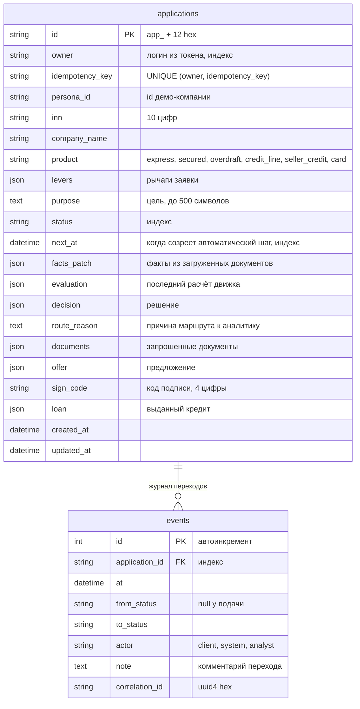

# Модель данных

Таблицы описаны в `api/conveyor.py` (SQLAlchemy Core) и создаются при старте (`metadata.create_all`).
PostgreSQL в Docker, SQLite локально и в тестах. Колонки JSON — тип `sa.JSON`.



Все даты — с часовым поясом (UTC).

Одну активную заявку на клиента, компанию и продукт гарантирует база, а не только код: частичный уникальный
индекс `uq_active_application` по `(owner, persona_id, product)` для всех статусов, кроме `REJECTED`, `ISSUED` и
`WITHDRAWN` (`api/conveyor.py`).
Повтор подачи с тем же ключом идемпотентности защищён ограничением `uq_owner_idempotency` по
`(owner, idempotency_key)`.

## JSON-поля заявки

**levers** — рычаги клиента (модель `Levers` в `api/app.py`); `bki_consent` при подаче всегда `true`:

```json
{"product": "express", "requested_amount": 6000000, "requested_term_m": 12, "has_rko": false,
 "bank_turnover_month_rub": 0, "guarantee": false, "marketplace": true, "insurance": true,
 "subscription": false, "bki_consent": true}
```

Ограничения: `requested_amount` 10 000 – 300 000 000, `requested_term_m` 1–120, `bank_turnover_month_rub`
0 – 10 000 000 000.

**evaluation** — ответ движка в формате `POST /api/v1/evaluations` (`api/dto.py`: исход, PD, класс риска, балл,
шанс одобрения, лимит, причины, стоп-факторы, запросы документов, маршрут, цена, платёж). Клиенту в ответе
заявки не отдаётся; аналитик видит выжимку в поле `risk`.

**decision**:

```json
{"outcome": "COUNTER", "title": "Предложим другие условия", "by": "system", "note": null,
 "reasons": [{"code": "L02", "category": "денежного потока с запасом DSCR ≥ 1,25 хватает на платёж только по этой сумме"}],
 "requests": [], "route": null}
```

`outcome`: `APPROVE`, `COUNTER`, `REQUEST_INFO`, `REJECT`; `by`: `system` или `analyst`; при стоп-факторе в
`reasons` — стоп-факторы (коды `S..`).

**offer**:

```json
{"product": "express", "product_label": "экспресс-кредит без залога", "amount": 3610000, "term_m": 12,
 "rate": 0.19026, "all_in": 0.25963, "monthly_payment": 332730.89}
```

`term_m` — `null` у возобновляемых продуктов; `rate` — ставка, `all_in` — ПСК, доли единицы.

**documents** — `[{"name": "отчётность за последний год", "status": "requested" | "uploaded"}]`.

**facts_patch** — объект фактов, которые перекрывают факты демо-компании после загрузки документов
(копия `after_docs` из файла компании).

**loan** (после `ISSUED`):

```json
{"number": "КД-2026-XXXXXX", "amount": 3610000, "term_m": 12, "rate": 0.19026, "monthly_payment": 332730.89,
 "product_label": "экспресс-кредит без залога", "issued_at": "2026-10-25T17:53:50+00:00",
 "account": "40702810001000001701"}
```

Номер договора — год и последние 6 символов id заявки; счёт — демо-номер `40702810` + ИНН + `01`.

## Файлы демо-компаний `demo/personas/*.json`

Синтетические, загружаются `api/personas.py` при старте.

| Поле | Содержание |
|---|---|
| `id`, `name`, `inn` | идентификатор, название, ИНН (регион 00) |
| `tagline`, `story`, `okved_name` | описание для интерфейса |
| `facts` | факты компании для движка: выручка, возраст, ОКВЭД, статус, налоговый долг, просрочки БКИ и др. |
| `levers` | рычаги по умолчанию (продукт, сумма, срок, флаги) |
| `expect` | ожидаемый исход движка (проверяется `scripts/check_personas.py`) |
| `after_docs` | (только `docs`) факты, которые появятся после загрузки документов |
| `mock.bki_fail` | (только `romashka`) мок БКИ не отвечает |
| `address` | необязательный адрес; по умолчанию «г. Москва (демо-адрес)» |

## Лента новостей `demo/news.json`

Массив синтетических новостей:

| Поле | Содержание |
|---|---|
| `id`, `date`, `tag`, `title`, `body` | новость |
| `priority` | порядок в ленте (меньше — выше), затем дата |
| `when` | условия показа: `okved_section`, `product`, `marketplace`, `tax_debt`, `young`, `overdue`, `app_status`, `any` |
| `why` | почему показано; шаблон с `{name}` и `{okved}` |
| `action` | необязательная кнопка действия или `null` |
