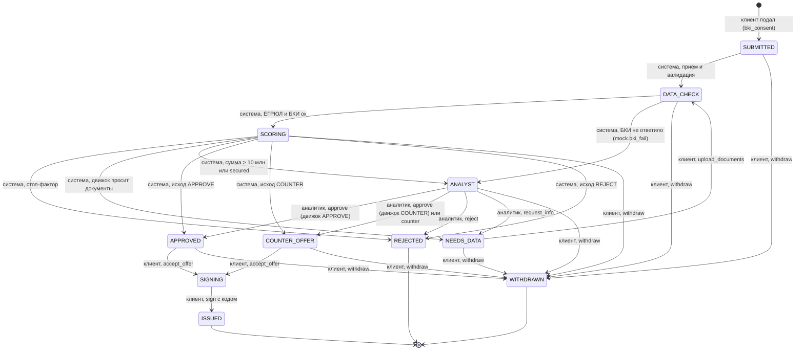

# Статусная машина заявки

Источник истины — `api/conveyor.py` (`LABELS`, `NEXT_STEP`, `AUTO`, `CLIENT_TURN`, `TERMINAL`, `CLIENT_ACTIONS`,
`ANALYST_ACTIONS`, `_score`, `advance`). Статус меняет только бэкенд; недопустимое действие в текущем статусе — 409,
действие чужой роли — 403. «Черновик» и «предоценка» — состояние песочницы до подачи, в БД не хранятся.

## Статусы

`whose_turn` в ответе API: `bank` — ход банка, `client` — ход клиента, `null` — конечный статус. Автоматические
статусы (`SUBMITTED`, `DATA_CHECK`, `SCORING`) двигаются сами через `PIPELINE_STEP_DELAY` секунд (`next_at`).

| Статус | Метка | Чей ход | Кто двигает | `next_step` | Действия клиента | Действия аналитика |
|---|---|---|---|---|---|---|
| `SUBMITTED` | Подана | bank | система | Заявка принята, проверяем комплектность | withdraw | — |
| `DATA_CHECK` | Проверка данных | bank | система | Сверяем данные с ЕГРЮЛ и запрашиваем кредитную историю | withdraw | — |
| `SCORING` | Скоринг | bank | система | Оцениваем заявку | withdraw | — |
| `NEEDS_DATA` | Нужны данные | client | клиент | Загрузите документы из списка — срок рассмотрения на паузе | upload_documents, withdraw | — |
| `ANALYST` | У аналитика | bank | аналитик | Заявку смотрит специалист, до 1 рабочего дня | withdraw | approve, counter, reject, request_info |
| `APPROVED` | Одобрено | client | клиент | Примите предложение, чтобы перейти к подписанию | accept_offer, withdraw | — |
| `COUNTER_OFFER` | Контрпредложение | client | клиент | Банк предлагает другие условия — примите их или отзовите заявку | accept_offer, withdraw | — |
| `SIGNING` | Подписание | client | клиент | Подпишите документы кодом с экрана | sign | — |
| `REJECTED` | Отказ | — (конечный) | — | Сейчас не сможем выдать кредит — причина и что изменить ниже | — | — |
| `ISSUED` | Выдано | — (конечный) | — | Деньги зачислены на расчётный счёт | — | — |
| `WITHDRAWN` | Отозвана | — (конечный) | — | Вы отозвали заявку | — | — |

## Правила действий

| Действие | Роль | Из статусов | В статус | Условия и ошибки |
|---|---|---|---|---|
| подача `POST /applications` | client | — | SUBMITTED | `bki_consent: true` иначе 422; активная заявка той же компании и продукта — 409; роль не client — 403 |
| `upload_documents` | client | NEEDS_DATA | DATA_CHECK | документы помечаются `uploaded`, факты дополняются `after_docs` компании |
| `accept_offer` | client | APPROVED, COUNTER_OFFER | SIGNING | выдаётся 4-значный `sign_code` |
| `sign` | client | SIGNING | ISSUED | `code` должен совпасть с `sign_code`, иначе 422; создаётся `loan` |
| `withdraw` | client | SUBMITTED, DATA_CHECK, NEEDS_DATA, SCORING, ANALYST, APPROVED, COUNTER_OFFER | WITHDRAWN | из SIGNING и конечных — 409 |
| `approve` | analyst | ANALYST | APPROVED или COUNTER_OFFER | `note` обязателен (422); пересчёт движком; если движок не даёт APPROVE/COUNTER или есть стоп-фактор — 409 |
| `counter` | analyst | ANALYST | COUNTER_OFFER | `note` и `amount` обязательны (422); на эту сумму движок должен дать APPROVE, иначе 409 с лимитом |
| `reject` | analyst | ANALYST | REJECTED | `note` обязателен |
| `request_info` | analyst | ANALYST | NEEDS_DATA | `note` обязателен, становится названием запрошенного документа |

Неизвестное действие — 422; действие другой роли — 403; действие не в своём статусе — 409.

## Шкала шагов трекера

Поле `steps` строится из текущего статуса и пройденных: `SUBMITTED → DATA_CHECK → [NEEDS_DATA] → SCORING →
[ANALYST] → решение → SIGNING → ISSUED`; `NEEDS_DATA` и `ANALYST` появляются, только если заявка через них прошла;
после `REJECTED` шагов подписания нет; при `WITHDRAWN` шкала обрывается на отзыве. Каждый шаг имеет `state`:
`done`, `current` или `todo`.
